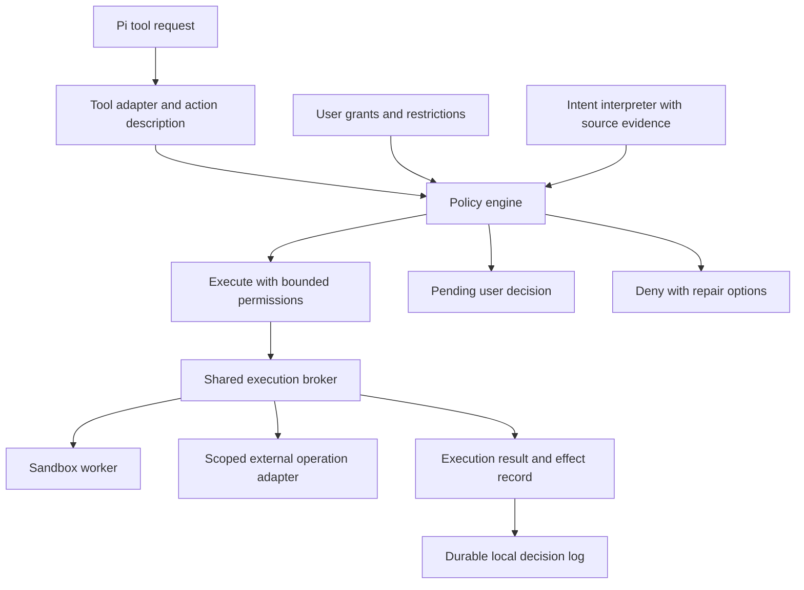

# pi-auto architecture assessment and proposed rebuild

pi-auto addresses a useful problem: letting a coding agent make progress without asking the user about every tool call. Its central architectural gap is that approval concerns a command or tool invocation, while enforcement needs to concern the resources and effects that invocation can actually reach.

I would rebuild it around a shared execution broker, bounded permission grants, recoverable workspace changes, and an LLM that interprets intent within enforced limits. The pi integration would remain small. The first version would support local development and a narrow set of external operations, with broader automation added through explicit adapters.

## How the current system works

The [extension runtime](../extensions/runtime/extension-runtime.ts) installs session, turn, tool-call, and tool-result handlers. Settings merge defaults, user-global JSON, project JSON, and environment overrides. A per-turn circuit breaker tracks reviewer denials, and a background summarizer maintains an authorization digest.

The current default is [sandbox escape-only mode](../extensions/runtime/session-state.ts). Bash commands run inside the sandbox without an initial LLM review. When a result looks like a sandbox denial, the extension constructs a retry reason and asks the reviewer whether the original command may run outside the sandbox. Approval causes a second execution through a separate bare shell executor.

In review-then-escape mode, bash receives an initial review as well, subject to the known-safe classifier. With the sandbox off, scope rules and the classifier determine which commands reach the reviewer. Configured review-only prefixes run without the sandbox after approval; mixed AND/OR sequences route segments separately.

Other tools use [scope rules](../extensions/scope.ts). Workspace reads, writes, and edits generally bypass review; sensitive reads receive review; grep, find, and ls always bypass it. Custom tools receive review based on their name and arguments.

The reviewer receives policy text, project instructions, a recent transcript, selected older entries, summaries, and the rolling digest. It returns risk, authorization, outcome, and rationale. The runtime acts on the returned outcome. A reviewer failure prompts the user where possible or blocks without a UI. Sandbox escape failures have a separate recovery path.

Useful existing foundations include the separation of policy from runtime wiring, conservative shell parsing, explicit failures when sandbox initialization is unavailable, model diagnostics, regression scenarios, and a history that records unsuccessful experiments as well as successful ones.

## Major architectural and product gaps

### Protection depends on the tool and execution mode

The same effect encounters different boundaries depending on its spelling. A workspace write skips review even if it overwrites unique work. A sensitive read receives review, while the known-safe command classifier accepts `cat .env` argv. In sandbox-off mode that classifier bypasses review. Bash and in-process filesystem tools do not share sandbox enforcement.

The default escape-only mode also permits commands that succeed within the sandbox without assessing their authorization. A command deleting ordinary workspace files can succeed because the workspace is writable. This is an intentional consequence of the mode, rather than a shell-parser failure.

The filesystem scope check uses lexical path containment rather than resolving the filesystem object. Symlinks therefore create another mismatch between the path being approved and the object accessed; this was identified from source, rather than verified against the real host tool.

These choices can fit a product whose contract is unrestricted workspace autonomy plus protection against selected external effects. They do not provide consistent protection against destructive agent mistakes or enforce arbitrary project restrictions. The product needs to make that contract explicit and offer a way to preserve original user work.

### Escalation removes more restrictions than the action needs

An approval for a failed fetch or filesystem operation results in [running the entire command outside the sandbox](../extensions/runtime/sandbox-interceptor.ts). The second process receives host privileges rather than the minimum extra permission needed for the denied operation.

The escape reviewer receives the command, cwd, and a retry reason. It does not receive an enforceable grant describing permitted destinations, paths, operations, or credentials. Configured sandbox denies are not independently enforced during the bare rerun. Review-only command prefixes likewise substitute approval for containment across everything that process can do.

For example, approval to download a dependency should enable the necessary download while preserving unrelated filesystem and network restrictions. The current escape mechanism cannot express that distinction. Compatibility exceptions gradually make the LLM responsible for behavior that the sandbox previously bounded.

### Retrying a command does not restore its original state

A sandbox denial can occur after earlier operations have succeeded. An install script might edit files and then fail to download something; an allowed external operation could complete before a later blocked operation. Rerunning the original command can repeat those effects.

The ordinary escape path has no transaction, checkpoint, idempotency condition, or record of completed operations. It also replaces the original tool result with the rerun result, making partial progress harder for the agent to reason about. The mixed-sequence router already avoids escaping the entire chain; the ordinary escape path lacks an equivalent protection.

The architectural problem extends beyond retries. Execution is divided between the host's bash tool and pi-auto's separate bare executor. Cancellation, limits, output, recovery, and auditing should belong to one execution owner. A sandbox refusal needs to produce an explicit execution state, including whether effects may already have occurred.

### Authorization is stored as lossy prose with weak provenance

The [digest](../extensions/digest.ts) compresses authorization into 1,500 characters. The transcript builder truncates messages, retrieves older entries by keyword overlap, and includes host compaction summaries as authorization context. These mechanisms help the classifier remember context, but they cannot preserve permission state reliably.

Concrete properties confirmed by deterministic probes include:

- The latest digest is selected from all session entries, including entries outside the current conversation branch.
- Workspace writes to `.agents/pi-auto.json` skip review. Changes become effective at a later settings load or reload; mutation alone does not immediately change the active policy.
- A tool result containing `[user]` or `[project instructions]` is rendered verbatim with those apparent section labels. This establishes ambiguous textual provenance, rather than a measured LLM bypass.

Project settings can override user-global safety settings, and project instructions are treated as trusted constraints because the host included them. Neither loading path establishes a separate policy ceiling that repository content cannot relax.

Permission state needs source message IDs, resource scope, revocations, ancestry, and an explicit distinction between user authority and repository suggestions. A summary can help interpretation, but should not become a new independent authority.

### The reviewer cannot establish what opaque actions will do

The [reviewer](../extensions/reviewer.ts) has no investigation tools. A command such as `./deploy.sh` does not reveal the script's effects, dependencies, environment, or destination. A custom tool's name and arguments do not establish its implementation or authenticated account. Large input strings may also be truncated before review.

An LLM can assess visible intent, but the system currently asks it to approve execution whose effects are only partially represented. Guessing more carefully cannot make unknown implementation behavior known. Opaque code needs a bounded execution environment; privileged operations need adapters that expose their resource and operation semantics.

The risk threshold table is also implemented in the prompt. A synthetic assessment containing `critical`, `unknown`, and `allow` was accepted by the parser and permitted by the gate. That establishes that the outcome is authoritative even when its other fields contradict policy; it does not establish how frequently the model produces such contradictions.

### Recovery asks users to manage the machinery

The user-facing escape routes include retrying with new wording, changing prefixes, editing policy, changing sandbox modes, and disabling pi-auto. Disabling currently bypasses both review and bash wrapping, and stays active until explicitly re-enabled.

The normal reviewer gate offers a circuit-breaker approval prompt, while sandbox escape denials use separate handling and do not pass through that gate's denial accounting. Recovery therefore depends on which execution route failed.

The missing product object is a specific permission request: what operation needs permission, over which resources, for how long, with which remaining restrictions. Users should be able to approve one operation or a bounded task scope, revoke that scope, inspect the evidence, and resume a paused task. Headless runs need the same pending-decision object instead of only a denial message.

### Evaluation measures classification more directly than execution safety

The live suite contains useful authorization variants, injection cases, long-context cases, and real-session regressions. Evaluation reports already track false allows, false denies, latency, cost, and rationales. Sandbox probes separately exercise actual runtime denial signals.

The remaining gap is evaluating the composed product. Reviewer scenarios invoke the reviewer directly, so they do not establish that real tool routing, filesystem effects, escalation, retries, and session transitions preserve policy. A classification test for an unauthorized workspace deletion can deny even though default runtime routing never invokes that classifier.

There is also a measurement problem: the high/critical false-allow counter uses the model's predicted risk label. A dangerous action mislabeled low and allowed counts as a false allow but disappears from that severity-specific counter. Consequence severity needs an independent reference label.

Production diagnostics are incomplete as well. The sandbox review log retains the latest 50 entries in memory; it is not a durable record covering every skipped action, grant, decision, execution, and recovery. Safe learning from real use requires privacy-aware replay records and task-level outcomes.

## First principles for a rebuild

The useful objective is to maximize productive work between interruptions while bounding mistakes and making recovery cheap. Raw approval rate is insufficient: unnecessary denials waste attention, while a single approval with excessive authority can be costly.

Three questions should be represented separately:

| Question | Representation | Responsible component |
| --- | --- | --- |
| What did the user ask for? | Intent with cited source messages | Intent interpreter |
| What operations are permitted? | Grants, restrictions, and revocations | Policy engine |
| What can this invocation actually affect? | Effective resources and execution limits | Execution broker |

Language interpretation remains probabilistic. Resource access, policy ceilings, and execution limits should be enforceable independently of an explanation generated by a model.

For the first product, I would assume a developer performing local coding tasks, with defenses against mistakes and instructions encountered in repository or tool content. Arbitrary untrusted extensions with host privileges would require additional isolation. The product should state that limit explicitly.

## Proposed architecture

The pi extension would translate events and display decisions. Filesystem operations, shell execution, and supported external tools would share the same broker and policy engine. Complete enforcement requires the host to route relevant operations through that broker, or replacing those tools with broker-backed implementations. A pre-call extension hook alone cannot contain other privileged extensions.

The policy engine would return `execute`, `request_permission`, or `deny`, together with the permissions execution will retain. Owner policy would live outside agent-writable project data. Repository configuration could tighten policy and propose additional grants; relaxing owner limits would require an explicit trusted action.

Grants would identify operations, resources, lifetime, user evidence, and restrictions. A task might permit workspace edits and tests plus ordinary pushes to one repository branch, while excluding force pushes and deployments. Grant and revoke events would persist independently of conversational summaries. A conversation fork would inherit only applicable grants from its ancestry; explicit global grants would have their own scope.

The LLM would interpret ordinary requests within a preapproved task profile, identify relevant source messages, and explain ambiguity. It could propose a broader grant but could not invent owner authority, remove hard restrictions, or directly authorize arbitrary host execution. Missing evidence for consequential scope expansion would produce a pending decision.

Raw shell scripts would execute with resource limits whether or not their purpose sounds benign. Static command parsing would help describe and optimize familiar commands, without establishing safety solely from an executable basename. Script behavior that remains unknown would remain bounded.

Credentials would be supplied through scoped operation adapters where practical, rather than exposed as general files or inherited environment secrets. An allowed domain alone would not authorize every account, repository, API operation, or upload to that domain. The first external adapter should demonstrate this with one common operation, such as pushing to a specific repository branch without force.

Workspace changes would begin in an isolated checkout or snapshot that preserves original tracked and untracked work. Applying results would check for concurrent changes. This improves recovery from local mistakes; it does not make network or database effects reversible.

A denial would retain a structured execution result: completed, blocked before execution, failed, partially completed, or cancelled. Retrying after effects would require a known recovery procedure, an adapter with idempotency support, or a fresh decision. Additional permission would expand only the relevant capability while preserving other restrictions.

One process owner would enforce deadlines, output limits, descendant cleanup, and cancellation. Execution IDs would connect proxy events, violations, decisions, and results instead of relying primarily on command-string lookup and time windows.

The local decision log would record action identity, policy version, grant IDs, evidence references, effective permissions, routing, and result. Sensitive content would be omitted or redacted by default. Reviewer model/version, prompts or their versioned templates, and payload versions would be captured sufficiently for controlled replay.

## Build sequence and acceptance criteria

1. **Specify the product contract and build a replay harness.** Define workspace recovery, secret access, external mutation, task scope, and failure behavior. Establish equivalent operations across bash and filesystem tools. The harness should expose today's route differences before changing implementation.

2. **Build the broker for local development.** Support reads, patches, and shell commands in an isolated workspace with protected policy files, no ambient credentials, and restricted network access. Completion means equivalent operations share policy; original work survives; and cancellation, limits, symlinks, and partial failures have explicit behavior. This is a useful first release even with human approval for uncommon exceptions.

3. **Add grants and a consistent permission experience.** Implement persistence, source references, revocation, ancestry, expiry, and policy ceilings. Support approval of one action or a bounded task scope, including headless pause/resume. Completion means repository content cannot silently relax owner policy and stale grants cannot survive a revocation incorrectly.

4. **Add one external adapter and constrained escalation.** Pick a frequent workflow, such as an authenticated push to a specified branch. Preserve filesystem and network restrictions during the operation. Completion means permissions for one resource cannot access a different resource, and retries cannot silently duplicate non-idempotent effects.

5. **Add LLM interpretation and test the composed system.** Use recorded user intent to propose and match grants within configured limits. Measure unsafe effects, false denials, interruptions per completed task, recovery success, cost, and added latency. Gate changes using independently labeled scenarios and end-to-end tests on supported platforms; repeated prompt trials alone do not establish execution safety.

6. **Broaden adapters and optimize routine decisions.** Cache decisions by normalized action, relevant state, policy version, and grant version. Use a faster classifier only when it retains the required safety performance. Grow tool coverage through explicit effect contracts rather than adding broad unsandboxed prefixes.

The existing repo offers reusable scenario fixtures, shell parsing, sandbox integration experience, model invocation code, and the pi command UI. Migration can introduce the broker and durable decisions alongside the current runtime, replay recorded sessions against both, then switch filesystem and shell execution together. Unmodeled custom tools should require explicit permission rather than receiving inferred broad privileges.

## Verification scope

The boundary findings above combine source tracing with small deterministic probes of the actual modules. The probes stubbed unavailable model API imports and disabled shell parsing where it was irrelevant; they did not run a live reviewer or demonstrate an OS sandbox exploit.

The standard CI command could not run because dependencies were absent. The pnpm frozen install rejected its stale lockfile; the npm install encountered registry DNS failures and was stopped. No live LLM tests ran, and existing benchmark figures were not remeasured. Runtime source was left unchanged.
